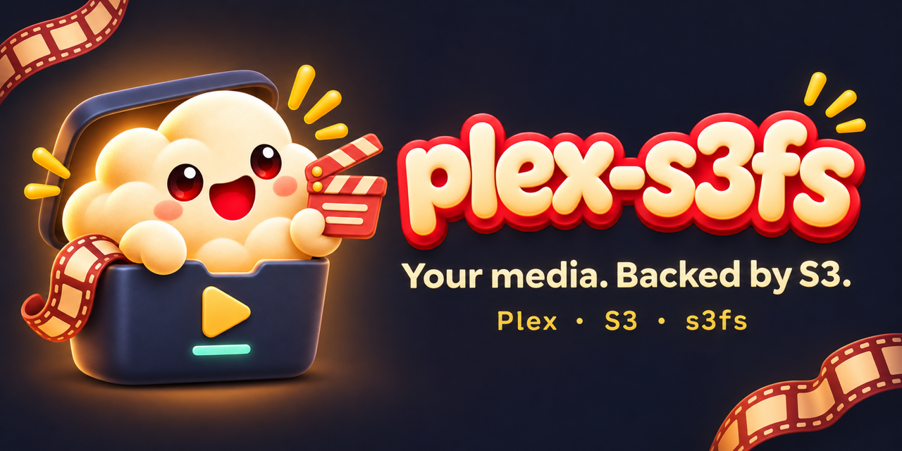

#  plex-s3fs




[](./LICENSE)
[](docs/development.md)


A Plex Media Server backed by an Amazon S3 bucket through s3fs.

This legacy Bash installer configures an Ubuntu host, installs Plex through
Snap, and adds an S3 filesystem mount. Review the deployment prerequisites
before running it: current Ubuntu, Snap confinement, FUSE permissions, and
Plex access to the mount require server-specific validation.

## Documentation

- [Getting started](docs/getting-started.md): prerequisites, reviewed installation,
  and headless server setup.
- [Architecture](docs/architecture.md): media flow, installer behavior, and limitations.
- [Local development](docs/development.md): Flox, Docker checks, and pre-commit.
- [Brand assets](assets/brand/README.md): logo, palette, and usage.

## Local verification

With Docker running:

```sh
flox activate -- ./test/verify.sh
```

Or run `./test/verify.sh` directly. The full local pipeline checks shell syntax,
ShellCheck, Markdown, Mermaid rendering, negative controls, and a 250-line
handwritten code/config budget. No hosted CI service is configured.

Verification never executes the installer, installs Plex, mounts S3, or uses
AWS credentials. See the [verification scope](docs/development.md) before deploying.

## Liability

The creator of this repo is not responsible if your machine ends up in a state
you are not happy with.

## License

Copyright © 2026 Nicholas Adamou.

The project is licensed under [PolyForm Shield License 1.0.0](LICENSE),
with Nicholas Adamou as the holder.

The original Apache license for earlier code is preserved in
[LICENSES/Apache-2.0.txt](LICENSES/Apache-2.0.txt); see [NOTICE](NOTICE).
