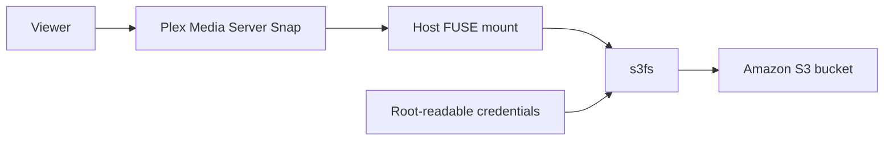

# Architecture

The project began as a way to keep a Plex library in S3 while running Plex on a
VPS. s3fs exposes bucket objects through a FUSE filesystem; Plex reads that
mount as a media directory. Plex itself is installed through Snap.

## Installer behavior

`install.sh` loads shared utilities over HTTPS, obtains sudo access, upgrades
APT packages, installs Plex and s3fs, and asks for a bucket and credentials.
It writes `/etc/passwd-s3fs`, prepares `/mnt/<bucket>`, adds a matching fstab
entry if absent, and invokes `mount -a` for all configured filesystems.

The script does not provision a bucket, define IAM policies, configure every
FUSE prerequisite, or verify Plex Snap permissions. It assumes a compatible
Ubuntu server and valid input. Remote utilities and system packages can change
independently of this repository. Review them before each deployment.

## Operational limits

Object storage access has different latency and filesystem semantics from a
local disk. Playback, scanning, seeking, cache behavior, mount recovery, and
restart behavior must be tested with your media and server configuration.
Keep independent backups. Neither successful static checks nor the architecture
diagram proves deployment compatibility or estimates cloud cost.

See [getting started](getting-started.md) for deployment preparation and
[local development](development.md) for the checks that can run without AWS.
