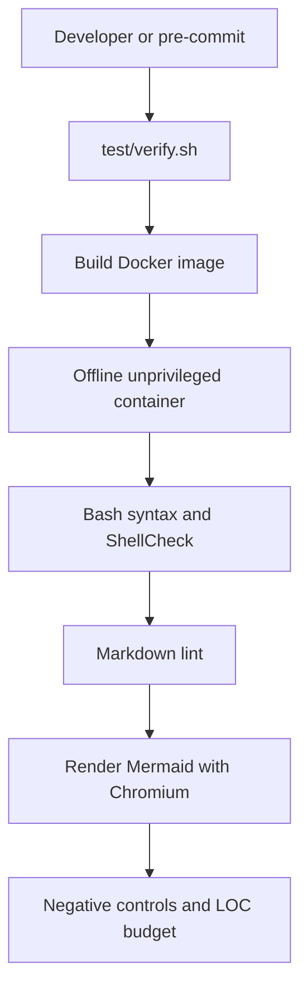

# Local development and verification

## Tools and first run

Install [Flox](https://flox.dev/docs/install-flox/) and Docker, then start the
Docker daemon. The checked-in Flox manifest and lock provide Bun and pre-commit
on macOS and Linux. Docker itself and its running daemon remain host prerequisites.

```sh
flox activate -- ./test/verify.sh
flox activate -- pre-commit install
flox activate -- pre-commit run --all-files
```

The Git hook invokes the exact same `./test/verify.sh` command, always runs, and
does not filter by changed filenames. Docker must be available when committing.
You can also run the canonical command directly without Flox.



## What is checked

- Every repository shell script gets Bash syntax and ShellCheck analysis.
- Every Markdown document, including the brand README, gets markdownlint-cli2
  checks. Long prose lines are allowed; inline HTML is restricted to images.
- Mermaid CLI reads Markdown directly and renders fenced diagrams as SVGs using
  Chromium. Invalid diagrams fail through the actual Mermaid parser.
- Deliberately invalid shell, Markdown, and Mermaid fixtures must be rejected.
- All source and configuration files copied into the image must fit
  within 250 nonblank lines. This includes the legacy installer, verification
  scripts, Dockerfile, package manifest, lint/browser/hook/Flox configuration,
  and ignore rules, plus any future source/config files. Generated `*.lock` files,
  Markdown, `docs/`, `assets/`, `LICENSES/`, `LICENSE`, and `NOTICE` are excluded.

The image build needs network access to fetch base images, Debian packages,
and Bun dependencies. Bun installs the exact dependency versions in `bun.lock`
with `--frozen-lockfile`; the image uses Bun 1.3.11. Node runs the upstream CLIs.
The validation container then runs without networking, root privileges, Linux
capabilities, or a writable root filesystem. A size-limited `/tmp` tmpfs holds
Chromium profiles, negative fixtures, and rendered diagrams, which are discarded
at exit. Chromium's internal sandbox is disabled inside this restricted container.

The checks do not execute `install.sh`, fetch its remote utilities, install Plex,
contact AWS, mount S3, validate live IAM policies, or test playback. They are
local static and documentation checks, not proof of deployment compatibility.
There are no hosted CI workflows.

## Update documentation tools

Update exact versions in `package.json`, then regenerate the dependency lock:

```sh
flox activate -- bun install --ignore-scripts
flox activate -- ./test/verify.sh
```

Bun manages the documentation tools; no application JavaScript runtime is added
to the installer. Keep dependencies, diagrams, and configuration small and review
lockfile changes. Review Flox updates with `flox update` separately.
