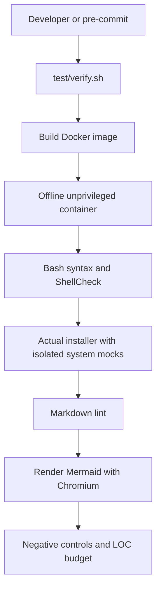

# Local development and verification

## Tools and first run

Install [Flox](https://flox.dev/docs/install-flox/) and Docker, then start the
Docker daemon. The checked-in Flox manifest and lock provide Bun and pre-commit
on macOS and Linux. Docker itself and its running daemon remain host prerequisites.

```sh
flox activate -- ./test/verify.sh
flox activate -- pre-commit install
flox activate -- pre-commit run --all-files
```

The Git hook invokes the exact same `./test/verify.sh` command, always runs, and
does not filter by changed filenames. Docker must be available when committing.
You can also run the canonical command directly without Flox.



## What is checked

- Every repository shell script gets Bash syntax and ShellCheck analysis.
- The real `install.sh` entry point runs inside Docker against a private fixture
  tree. Fake input reaches the actual Bash `read` prompts through stdin; no
  prompt functions are replaced. An exported sudo mock allows only exact
  expected arguments. A private PATH has no fallbacks for system or network
  commands. Unexpected calls and merged argument boundaries fail closed.
- Integration assertions inspect actual credential bytes and mode `0600`,
  fstab bytes, mount-directory creation, the exact ordered command sequence,
  repeat-run idempotence, and absence of fake credentials from captured output
  and command logs. Injected sudo, APT/Snap installation, credential write/mode,
  directory creation, fstab write, and mount failures must abort nonzero before
  later commands. Empty bucket/credential values and EOF at each prompt abort
  before sudo or filesystem writes.
- Every Markdown document, including the brand README, gets markdownlint-cli2
  checks. Long prose lines are allowed; inline HTML is restricted to images.
- Mermaid CLI reads Markdown directly and renders fenced diagrams as SVGs using
  Chromium. Invalid diagrams fail through the actual Mermaid parser.
- Deliberately invalid shell, Markdown, and Mermaid fixtures must be rejected.
- All source and configuration files copied into the image must fit
  within 350 nonblank lines. This includes the legacy installer, verification
  scripts and integration mocks/fixtures, Dockerfile, package manifest, lint/browser/hook/Flox configuration,
  and ignore rules, plus any future source/config files. Generated `*.lock` files,
  Markdown, `docs/`, `assets/`, `LICENSES/`, `LICENSE`, and `NOTICE` are excluded.

The image build needs network access to fetch base images, Debian packages,
and Bun dependencies. Bun installs the exact dependency versions in `bun.lock`
with `--frozen-lockfile`; the image uses Bun 1.3.11. Node runs the upstream CLIs.
The validation container then runs without networking, root privileges, Linux
capabilities, or a writable root filesystem. A size-limited `/tmp` tmpfs holds
Chromium profiles, negative fixtures, and rendered diagrams, which are discarded
at exit. Chromium's internal sandbox is disabled inside this restricted container.

The installer uses Bash input/output and direct system commands without a
network bootstrap. It stops on failed commands, creates mount directories with sudo and matches complete fstab lines for reruns.
`PLEX_S3FS_ROOT` optionally prefixes filesystem paths to stage configuration;
it does not disable package installation or mounting. Only the Docker test
harness supplies the fail-closed mocks. Never use the staging prefix as a
standalone dry-run option on your host.

Integration executes the production installer. Package installation and mounting
are mocked; real file writes happen only in the private `/tmp` tree with
fake credentials. The suite does not install Plex, contact AWS, mount S3, validate
live IAM policies, or test playback. Actual Ubuntu/Snap/FUSE behavior and cloud
permissions still require deployment testing. There are no hosted CI workflows.

## Update documentation tools

Update exact versions in `package.json`, then regenerate the dependency lock:

```sh
flox activate -- bun install --ignore-scripts
flox activate -- ./test/verify.sh
```

Bun manages the documentation tools; no application JavaScript runtime is added
to the installer. Keep dependencies, diagrams, and configuration small and review
lockfile changes. Review Flox updates with `flox update` separately.
