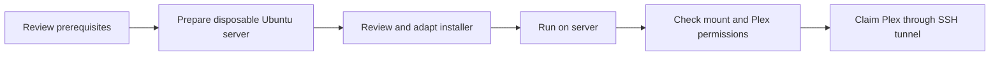

# Getting started

## Prepare a server

Use a disposable Ubuntu server with APT, Snap, systemd, FUSE, and sudo access.
DigitalOcean was the original deployment target; another VPS can provide the
same prerequisites. Compatibility with the latest Ubuntu and Plex Snap releases
is not established by local verification.

Create an S3 bucket and a dedicated identity restricted to that bucket. Plan
storage, request, retrieval, and data transfer costs for your library using the
[AWS pricing calculator](https://calculator.aws/). The original project targeted
small libraries; library size alone does not determine cost.

The installer prompts for an access key ID and secret, writes them to
`/etc/passwd-s3fs` with mode `600`, and modifies `/etc/fstab`. Never commit keys
or use account root credentials. Review the bucket policy, region, s3fs options,
and credential rotation process before deployment.

## Review and install

Clone this repository and read `install.sh`. It uses Bash and standard system
commands directly, without downloading or importing another shell script. It
reads the bucket and credentials before requesting sudo access; both credential
prompts hide typed input. Empty values and interrupted input abort before changes.

The installer then upgrades packages, installs Plex with `snap install` and s3fs
with `apt install -y`, writes credentials and persistent mounts, and runs
`mount -a`. Package managers still require their normal repository access.
Back up the server configuration first.

The installer creates `/mnt/<bucket>` with sudo. Verify its ownership and FUSE `allow_other` configuration and Plex Snap access to the mount.
Do not assume installing the Snap makes the S3 directory readable by Plex.

On the prepared server, after reviewing and adapting the script:

```sh
bash ./install.sh
```

This is a deployment command, not a development check. The installer has no
rollback or dry-run mode; test changes on a disposable server first.

## Configure a headless Plex server

Forward the server's Plex port to your computer:

```sh
ssh -L 32400:localhost:32400 -N username@server-address
```

Open `http://localhost:32400/web` locally to complete the Plex first-run setup
and account claim. Add the mounted media directory to your library only after
confirming Plex can read it. Keep the server secured and avoid exposing
administrative interfaces unnecessarily.


